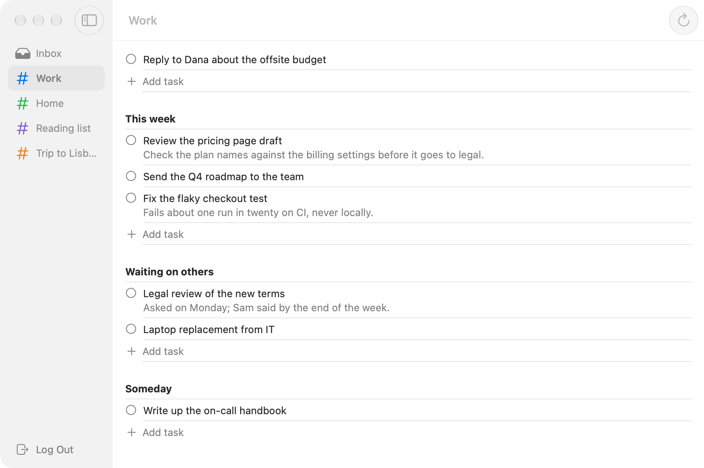
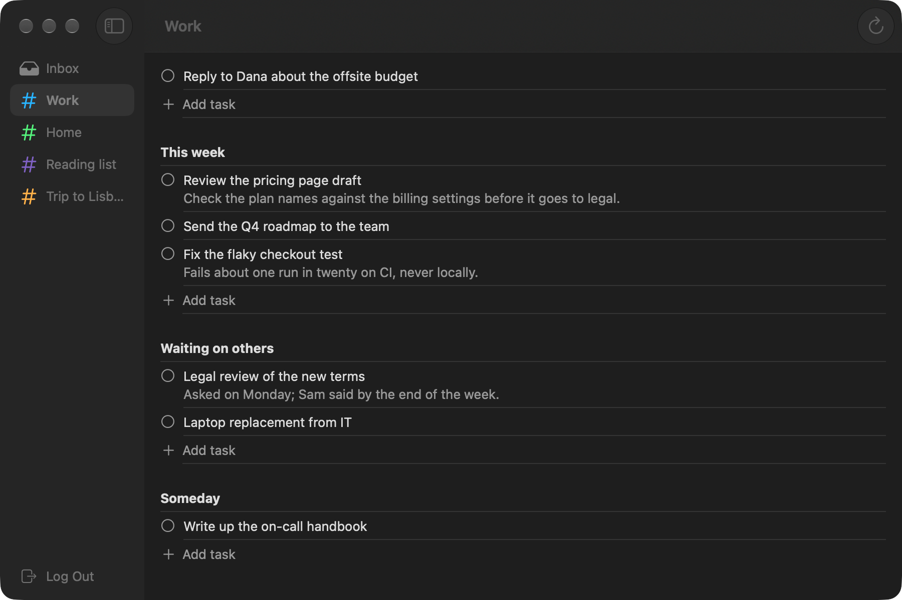

# darkroom

Renders a macOS app's SwiftUI views to PNG, light and dark, without
launching the app.

You can check a UI change while the app keeps running: recording something,
signed in, or in front of you. Nothing appears on screen, and nothing takes
focus. Coding agents can use it the same way: change a view, render it, look
at the PNG.

| Light | Dark |
| --- | --- |
|  |  |

<sub>A to-do app's main window, drawn from sample data, with its glass sidebar
and toolbar.</sub>

## How it works

`darkroom init` adds a small Swift package next to your Xcode project, in
`tools/shots`. Its executable target links your app's source folders and
compiles them with the app target's Swift settings: language mode, default
actor isolation, upcoming features, approachable concurrency and compilation
conditions. It leaves out the app's `@main` file and anything that isn't
Swift.

In that package you list **shots**: views as the app shows them, fed by
sample data. Running it hosts each shot in a window far off screen and draws
it, at the screen's scale, in light and dark:

- **Whole windows** (`window: true`) are captured with ScreenCaptureKit, as
  the window server composites them: title bar, toolbar, glass sidebar,
  selection. A process may capture its own windows without the Screen
  Recording permission.
- **Single views** are drawn the way AppKit caches a view's display.

## Install

```sh
git clone https://github.com/alxgsv/darkroom
cd darkroom
swift build -c release
cp .build/release/darkroom ~/.local/bin/   # or anywhere on your PATH
```

## Set up a project

In your repository, or the folder with your `.xcodeproj`:

```sh
darkroom init
```

```
Set up tools/shots for Notes:
  sources    Notes/ → Notes
  left out   1 × The app's entry point: Shots.swift has this executable's.
  left out   2 × Not Swift.
  settings   .swiftLanguageMode(.v5) .defaultIsolation(MainActor.self) …
Building…
Built.

Next: put the app's views in tools/shots/Sources/Shots/Shots.swift, then
  cd tools/shots && swift run notes-shots
```

`init` builds the package once, to show the setup works, and writes a README
there on running the shots, for teammates and coding agents. Options:

| Flag | Meaning |
| --- | --- |
| `--project <path>` | The Xcode project. Default: the only one in this folder or two levels below. |
| `--target <name>` | The app's target. Default: the one named like the project. |
| `--into <dir>` | Where the package goes. Default: `tools/shots` at the top of the git repository, or next to the project outside one. |
| `--replace <file>` | An app file to leave out and copy into `Stand-ins/`. Repeatable. See below. |
| `--local <dir>` | Depend on a darkroom checkout instead of this repository. |
| `--no-build` | Skip the check build. |

Swift packages the target links, remote or local, become the package's
dependencies too.

## Write shots

`Sources/Shots/Shots.swift`:

```swift
import Darkroom
import SwiftUI

@main
@MainActor
enum Main {
    static func main() {
        develop([
            Shot("window", "The main window", width: 900, height: 600, window: true) {
                ContentView().environment(Library.sample)
            },
            Shot("row", "A note in the list", width: 320) {
                NoteRow(note: .sample).padding()
            },
        ])
    }
}
```

A `Shot` has a name, a line about it, a width, and a height (`nil` fits the
view). Put each view in the container the app puts it in: a grouped `Form`,
a `List`.

When the shots need sample data that takes work to make, such as files in a
temporary folder, make it in `prepare`. It runs once before the first shot,
and each shot's closure gets what it returns. `finish` cleans it up:

```swift
develop([
    Shot<Samples>("library", "The library", width: 900, height: 600, window: true) { samples in
        LibraryView(store: samples.store)
    },
], prepare: { try await Samples() }, finish: { $0.remove() })
```

## Stand-ins

The app's views often reach things a picture shouldn't: the Keychain, the
network, other apps. Replace the files that do. They're left out of the
package and copied into `Sources/Shots/Stand-ins/` for you to edit:

```sh
darkroom init --replace Services/KeychainStore.swift --replace Networking/APIService.swift
```

Keep the types and methods the app calls, and answer from sample data. Each
copy starts with an `#error`, so the package won't build until you've edited
it. The rest of the app, view models included, runs as it does in the app.

## Run

```sh
cd tools/shots
swift run notes-shots                      # every shot, light and dark
swift run notes-shots row --appearance dark
swift run notes-shots --list
```

Each file's path is printed as it's written, `<shot>-light.png` and
`<shot>-dark.png`.

| Flag | Meaning |
| --- | --- |
| `--out <dir>` | Where the PNGs go. Default: `$TMPDIR/<executable>`. |
| `--appearance light\|dark\|both` | Default: `both`. |
| `--wait <seconds>` | How long a view runs before it's drawn, for `.task` loads. Default: `2.5`. |
| `--list` | The shots and what each shows. |

The app's `@AppStorage` reads the executable's own defaults domain, which
starts empty on every run. Set what a shot needs in `prepare`.

## Requirements

- An Xcode 26 toolchain (Swift 6.2).
- macOS 14.4 or later to capture whole windows; single views draw on 14.
- A macOS app target with folder-based groups (Xcode 16 and later).

## Limits

- Resources aren't in the package: images from the app's asset catalog don't
  load. SF Symbols do.
- Whatever the `@main` file defines besides the app is missing. Move it to
  another file.
- `OTHER_SWIFT_FLAGS` aren't carried over; `init` prints them.
- Single-view shots leave out glass and draw a selected list row's highlight
  as a black block. Use `window: true` for those.
- Windows draw as inactive, there's no hover, and popovers, sheets and alerts
  aren't captured.

## License

MIT
